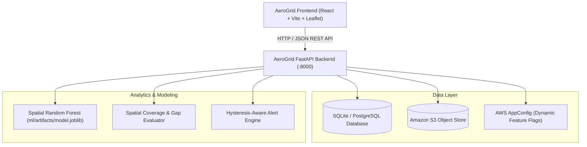
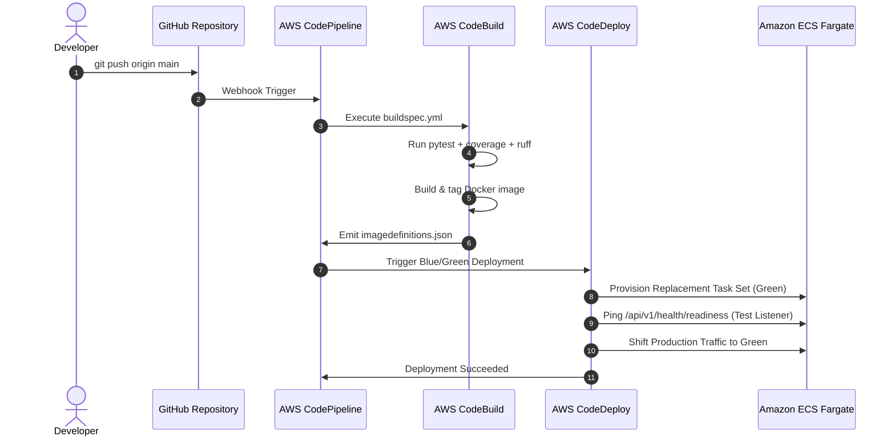

# AeroGrid Architectural Blueprint

AeroGrid is a location-aware environmental intelligence and early warning platform designed for continuous particulate monitoring, spatial cross-validation, and predictive hazard mitigation.

---

## 1. System Context & Component Architecture

---

## 2. Release & CI/CD Pipeline

---

## 3. Provider Abstraction Pattern

The platform enforces clean decoupled boundaries via dependency inversion:
1. **`BaseStorageProvider`**: Transparently switches between `LocalStorageProvider` and `S3StorageProvider`.
2. **`BaseConfigProvider`**: Dynamically polls `AppConfigProvider` with session token rotation, falling back to static environment variables.
3. **`BaseMLProvider`**: Supports `SklearnModelAdapter` with calibrated 95% confidence intervals and `DemoProvider` fallback.
4. **`BaseDataProvider`**: Ingests live CPCB / OpenAQ observations with realistic deterministic demo fallbacks.
